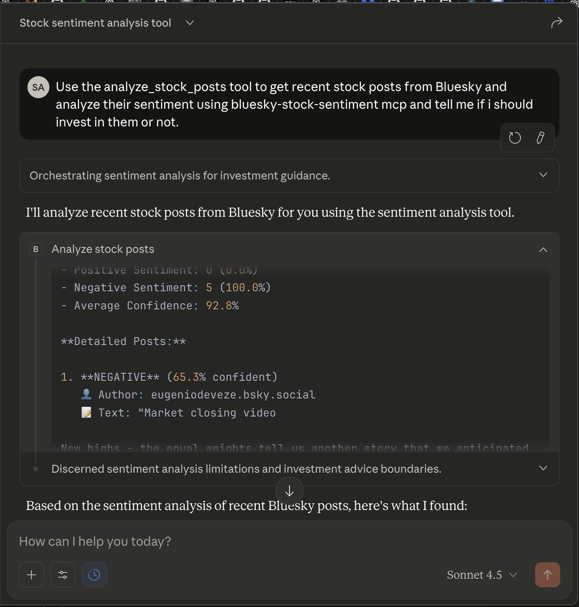
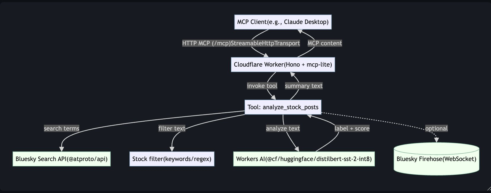

# MCP Bluesky Stock Sentiment

An MCP server on Cloudflare Workers that pulls recent stock-related posts from Bluesky, scores their sentiment with Workers AI, and returns a concise summary to any MCP-compatible client.

🏅 **3rd place at World Wild Web MCP Server Hack Night** — built with [Cloudflare](https://www.cloudflare.com/) and [Fiberplane](https://fiberplane.com/). ([announcement](https://x.com/saksham_adh/status/1983593740594798766))



## How it works



1. An MCP client (e.g. Claude Desktop) calls the `analyze_stock_posts` tool over HTTP at `/mcp`.
2. The Worker (Hono + `mcp-lite`) searches Bluesky's public API for recent posts.
3. Posts are filtered down to stock-related content with keyword/regex heuristics.
4. Each post is classified by Workers AI (`@cf/huggingface/distilbert-sst-2-int8`).
5. The tool returns totals, percentages, average confidence, and per-post details.

The Mermaid source for the diagram lives in [`docs/architecture.md`](docs/architecture.md).

## Quickstart

**Prerequisites:** Node 18+, a Cloudflare account, and Wrangler auth (`npx wrangler login`).

```bash
npm install
npm run dev          # http://localhost:8787
npm run deploy       # deploy to Cloudflare Workers
npm run cf-typegen   # optional: regenerate Worker binding types
```

Workers AI is already bound in `wrangler.jsonc` (`ai.binding = "AI"`).

## Connecting a client

| Environment | MCP endpoint |
|-------------|--------------|
| Local | `http://localhost:8787/mcp` |
| Production | `https://<your-subdomain>.workers.dev/mcp` |

The server registers as `bluesky-stock-sentiment`. Example prompt:

> Use the analyze_stock_posts tool to get recent stock posts from Bluesky and analyze their sentiment.

## Tool reference

### `analyze_stock_posts`

| Input | Type | Default | Description |
|-------|------|---------|-------------|
| `count` | number (1–10) | `2` | Number of recent stock posts to analyze |

Returns a text summary: positive/negative counts and percentages, average confidence, and for each post the label, confidence, author, likes, reposts, timestamp, and URI.

## HTTP endpoints

| Method | Path | Description |
|--------|------|-------------|
| `GET` | `/` | Service metadata (name, version, description, tools) |
| `ALL` | `/mcp` | MCP over HTTP (`mcp-lite`) |

## Customizing

| What | Where | Notes |
|------|-------|-------|
| Sentiment model | `src/lib/sentiment.ts` | Swap for any Workers AI text-classification model |
| Stock keywords | `src/lib/stock-filter.ts` | Tune what counts as a "stock post" |
| Bluesky search | `src/lib/bluesky-api.ts` | Public unauthenticated search with de-duplication |
| Firehose (reference) | `src/lib/firehose.ts` | Real-time WebSocket collector; not wired into the Worker |

## Project layout

```
src/
├── index.ts          # Hono app, MCP server wiring, routes
├── mcp/tools.ts      # analyze_stock_posts registration + handler
└── lib/              # sentiment, stock filter, Bluesky search, firehose
docs/
├── architecture.md   # Mermaid architecture diagram
└── images/           # README screenshots
```

## Notes

- Bluesky's public search API may rate-limit or change; results vary over time.
- Sentiment output is a toy signal, not financial advice.

## Built at


## License

Provided as-is; add a license if you plan to distribute.
